  

  

  
  
  

 

<h3 align="center">About me</h3>

  🎓 Studying <b>Computer Science</b> and <b>Math</b> at <b>Rhodes College</b> 
  🔭 Building <b>cairn</b>, an AI agent that maps and cleans up Splunk via MCP 
  🤖 And <b>phantom-dev</b>, a vision-first autonomous computer operator 
  ⚡ Into AI agents, hackathons, fast interfaces and good coffee

 

<h3 align="center">Tech stack</h3>

  

 

<h3 align="center">Stats</h3>

  <picture>
    <source media="(prefers-color-scheme: dark)" srcset="./profile/stats-dark.svg" />
    
  </picture>
  <picture>
    <source media="(prefers-color-scheme: dark)" srcset="./profile/langs-dark.svg" />
    
  </picture>

  <picture>
    <source media="(prefers-color-scheme: dark)" srcset="./profile/streak-dark.svg" />
    
  </picture>

  <picture>
    <source media="(prefers-color-scheme: dark)" srcset="./profile/snake-dark.svg" />
    
  </picture>

  

